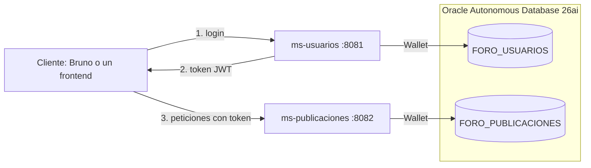
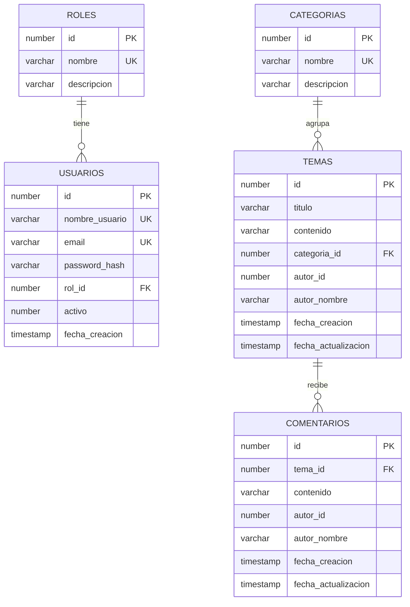

# Foro de TCG: infraestructura

Foro en línea para jugadores de cinco juegos de cartas coleccionables: Magic The Gathering, Mitos y Leyendas, Pokemon TCG, One Piece TCG y Yu-Gi-Oh!

Este repositorio levanta el backend completo con un solo comando. Aquí están el `docker-compose`, la carga inicial de Oracle Cloud y la colección de Bruno con las pruebas de todos los endpoints.

El sistema se divide en tres repositorios:

| Repositorio | Contenido |
|---|---|
| `foro-ms-usuarios` | Usuarios, roles e inicio de sesión |
| `foro-ms-publicaciones` | Categorías, temas, comentarios y búsqueda |
| `foro-infra` | Este repositorio |

## Arquitectura



- Cada microservicio es dueño de sus datos y tiene su propio esquema en Oracle.
- Los microservicios se conectan a Oracle Cloud con el Wallet, que se monta como solo lectura y nunca se sube a git.
- `ms-usuarios` entrega un token JWT firmado con el id, el nombre y el rol del usuario.
- `ms-publicaciones` valida ese token con el mismo secreto, así que no necesita llamar a `ms-usuarios`. Si uno de los dos se detiene, el otro sigue funcionando.
- Cada tema y comentario guarda el id y el nombre de su autor. Ese id no lleva clave foránea porque el usuario vive en otro esquema.

## Modelo de datos



`ROLES` y `USUARIOS` están en `FORO_USUARIOS`. Las otras tres tablas están en `FORO_PUBLICACIONES`.

## Roles

| Permiso | USUARIO | MODERADOR | ADMIN |
|---|---|---|---|
| Publicar, comentar y editar lo propio | Sí | Sí | Sí |
| Borrar temas y comentarios propios | Sí | Sí | Sí |
| Borrar temas y comentarios de otros | No | Sí | Sí |
| Gestionar categorías | No | No | Sí |
| Gestionar usuarios y roles | No | No | Sí |

## Cómo levantarlo

Necesitas Docker Desktop, una Autonomous Database en Oracle Cloud y su Wallet descomprimido. Los tres repositorios van en la misma carpeta:

```
carpeta/
├── foro-infra/
│   └── Wallet_dbfullstack3/
├── foro-ms-usuarios/
└── foro-ms-publicaciones/
```

Dentro de `foro-infra`, copia el archivo de variables y completa sus valores:

```bash
cp .env.example .env
```

La primera vez, crea los esquemas y carga los datos iniciales. Este paso se hace una sola vez y después ya no se necesita la clave de ADMIN:

```bash
docker compose run --rm cargar-bd
```

Luego levanta los microservicios:

```bash
docker compose up -d --build --wait
```

| Servicio | Dirección |
|---|---|
| ms-usuarios | http://localhost:8081 |
| ms-publicaciones | http://localhost:8082 |

Para detenerlos:

```bash
docker compose down
```

Los datos quedan guardados en Oracle Cloud. Una base Always Free se detiene tras 7 días sin uso, así que si los servicios no parten, revisa que esté encendida en la consola de Oracle Cloud.

## Usuarios de prueba

Todos usan la clave `Foro2026*`.

| Usuario | Rol |
|---|---|
| `admin` | ADMIN |
| `moderador` | MODERADOR |
| `camila` | USUARIO |
| `diego` | USUARIO |

## Pruebas con Bruno

La colección está en la carpeta `bruno`. Tiene 43 solicitudes y cada una revisa su respuesta, incluidos los casos de error 400, 401, 403, 404 y 409.

1. Abre Bruno y elige **Open Collection** con la carpeta `bruno`.
2. Selecciona el ambiente `local`.
3. Ejecuta primero la carpeta `01 Inicio de sesion`, porque ahí se guardan los tokens que usan las demás.

También se puede ejecutar completa desde la terminal, dentro de la carpeta `bruno`:

```bash
npx @usebruno/cli@4.3.0 run -r --env local
```

## Revisar los datos en Oracle

En la consola de Oracle Cloud, abre la base y entra a **Database Actions > SQL** con el usuario ADMIN:

```sql
SELECT t.id, t.titulo, c.nombre AS categoria, t.autor_nombre
FROM foro_publicaciones.temas t
JOIN foro_publicaciones.categorias c ON c.id = t.categoria_id
ORDER BY t.id;
```
