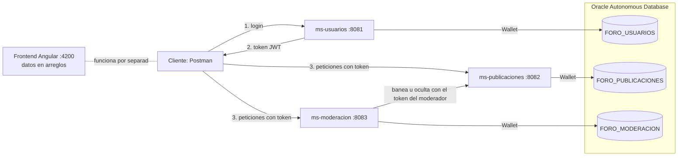
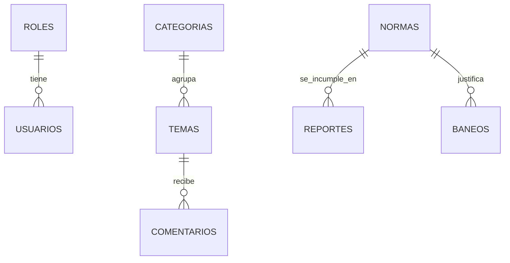

# Foro de TCG: infraestructura

Foro en línea para jugadores de cinco juegos de cartas coleccionables: Magic The Gathering, Mitos y Leyendas, Pokemon TCG, One Piece TCG y Yu-Gi-Oh!

Este repositorio une todo el sistema: el `docker-compose` local, el de la nube, los scripts de Oracle Cloud y las colecciones de Postman y Bruno.

| Repositorio | Contenido | Versión |
|---|---|---|
| `foro-ms-usuarios` | Usuarios, roles e inicio de sesión (puerto 8081) | 1.1.0 |
| `foro-ms-publicaciones` | Categorías, temas, comentarios y búsqueda (puerto 8082) | 1.1.0 |
| `foro-ms-moderacion` | Normas, reportes y baneos (puerto 8083) | 1.0.0 |
| `foro-frontend` | Frontend en Angular 22 con Bootstrap | 1.0.0 |
| `foro-arquetipo` | Arquetipo Maven con el que se crean los microservicios | 1.0.1 |
| `foro-infra` | Este repositorio | 2.0.0 |

## Arquitectura



- Cada microservicio es dueño de sus datos y tiene su propio esquema en Oracle.
- Los microservicios se conectan a Oracle Cloud con el Wallet, que se monta como solo lectura y nunca se sube a git.
- `ms-usuarios` entrega un token JWT firmado con el id, el nombre y el rol del usuario. Los otros dos lo validan con el mismo secreto.
- `ms-moderacion` llama a `ms-publicaciones` para ocultar el contenido baneado. Le reenvía el token del moderador, así `ms-publicaciones` vuelve a revisar el rol.
- Como pide la actividad, el frontend funciona por separado: trabaja con sus propios datos en arreglos.

## Roles

| Permiso | USUARIO | MODERADOR | ADMIN |
|---|---|---|---|
| Publicar, comentar y editar lo propio | Sí | Sí | Sí |
| Reportar temas y comentarios | Sí | Sí | Sí |
| Borrar temas y comentarios de otros | No | Sí | Sí |
| Revisar reportes y banear contenido | No | Sí | Sí |
| Levantar baneos y gestionar normas | No | No | Sí |
| Gestionar categorías, usuarios y roles | No | No | Sí |

## Modelo de datos



| Esquema | Tablas |
|---|---|
| `FORO_USUARIOS` | `roles`, `usuarios` |
| `FORO_PUBLICACIONES` | `categorias`, `temas`, `comentarios` (temas y comentarios tienen la columna `baneado`) |
| `FORO_MODERACION` | `normas`, `reportes`, `baneos` |

Los reportes y baneos guardan el tipo (`TEMA` o `COMENTARIO`) y el id del contenido. No llevan clave foránea porque ese contenido vive en otro esquema.

## Cómo levantarlo en local

Necesitas Docker Desktop y la Autonomous Database con su Wallet descomprimido en la raíz del disco:

```
C:\Wallet_dbfullstack3
```

Los repositorios van en la misma carpeta:

```
carpeta/
├── foro-infra/
├── foro-frontend/
├── foro-ms-usuarios/
├── foro-ms-publicaciones/
└── foro-ms-moderacion/
```

Dentro de `foro-infra`, copia el archivo de variables y completa sus valores:

```bash
cp .env.example .env
```

### Preparar Oracle

Para una base nueva, este comando crea los tres esquemas y carga los datos:

```bash
docker compose run --rm cargar-bd
```

Si la base ya tiene la versión 1 (semana 2), este otro agrega el esquema de moderación y la columna `baneado`:

```bash
docker compose run --rm migrar-bd
```

Los dos usan la clave de ADMIN del `.env`. Si no la tienes, crea el usuario `FORO_MODERACION` desde Database Actions con `db/01_crear_esquema_moderacion.sql` y deja vacía la clave de ADMIN: el script de migración se salta ese paso.

### Levantar los servicios

```bash
docker compose up -d --build --wait
```

| Servicio | Dirección |
|---|---|
| frontend | http://localhost:4200 (o el puerto de `FRONTEND_PUERTO`) |
| ms-usuarios | http://localhost:8081 |
| ms-publicaciones | http://localhost:8082 |
| ms-moderacion | http://localhost:8083 |

Para detenerlos:

```bash
docker compose down
```

Una base Always Free se detiene tras 7 días sin uso. Si los servicios no parten, revisa que esté encendida en la consola de Oracle Cloud.

## Despliegue en la nube

Las imágenes están publicadas en Docker Hub:

| Imagen | Versión |
|---|---|
| `robertoasf/foro-ms-usuarios` | 1.1.0 |
| `robertoasf/foro-ms-publicaciones` | 1.1.0 |
| `robertoasf/foro-ms-moderacion` | 1.0.0 |
| `robertoasf/foro-frontend` | 1.0.0 |

Se construyen y suben con `nube/publicar-imagenes.sh`, después de `docker login`.

La carpeta `nube` tiene un `docker-compose.yml` que no compila nada: baja esas imágenes de Docker Hub. Play with Docker dejó de funcionar el 1 de marzo de 2026, así que el despliegue se hace en **GitHub Codespaces**, que entrega una máquina en la nube con Docker y URL públicas por puerto:

1. Crear un Codespace sobre este repositorio (2 núcleos, 8 GB).
2. Copiar a la carpeta `nube` el `.env` (ver `nube/.env.example`, con `FRONTEND_PUERTO=4200`) y el Wallet descomprimido en `Wallet_dbfullstack3`.
3. Levantar los servicios:

   ```bash
   cd nube
   docker compose up -d --wait
   ```

4. En la pestaña **Puertos** reenviar 4200, 8081, 8082 y 8083 y dejarlos con visibilidad **Public**.

Las direcciones quedan así: `https://<codespace>-<puerto>.app.github.dev`. La primera vez que se abre una de ellas en el navegador, GitHub muestra un aviso; se acepta con **Continue**.

El mismo `docker-compose.yml` funciona en cualquier máquina con Docker, por ejemplo una VM en la nube: basta con abrir los puertos 80, 8081, 8082 y 8083.

## Pruebas con Postman

La colección está en `postman/Foro TCG.postman_collection.json`. Tiene 85 peticiones y cada una revisa su respuesta, incluidos los casos de error 400, 401, 403, 404 y 409.

| Carpeta | Qué prueba |
|---|---|
| 00 Estado de los servicios | Que los tres microservicios respondan UP |
| 01 Inicio de sesion | Login de admin, moderador, camila y diego. Guarda los tokens |
| 02 Usuarios | Registro, permisos por rol, cambio de rol, desactivar y eliminar |
| 03 Categorias | CRUD de categorías y resumen |
| 04 Temas | Publicar, buscar, editar y permisos |
| 05 Comentarios | Comentar, editar y borrar como moderador |
| 06 Moderacion | Normas, reportes, baneo, contenido oculto, levantar baneo y descartar reportes |

1. En Postman, **Import** de la colección y de los ambientes `local` o `nube`.
2. Elegir el ambiente y ejecutar la colección completa con **Run**, en orden.

También se puede ejecutar desde la terminal, dentro de la carpeta `postman`:

```bash
npx newman run "Foro TCG.postman_collection.json" -e local.postman_environment.json
```

La colección de Bruno de la semana 2 sigue en la carpeta `bruno`.

## Usuarios de prueba

Todos usan la clave `Foro2026*`.

| Usuario | Rol |
|---|---|
| `admin` | ADMIN |
| `moderador` | MODERADOR |
| `camila` | USUARIO |
| `diego` | USUARIO |

## Ramas y versiones

Se trabaja con **Trunk Based Development**: cada repositorio tiene una rama principal `main` y cada cambio se hace en una rama corta `feature/*` que se une a `main` apenas está lista. Así cada microservicio avanza por separado y `main` siempre compila.

Las versiones siguen versionado semántico y quedan marcadas con tags:

| Tag | Qué marca |
|---|---|
| `v1.0.0` | Entrega de la semana 2 (backend con usuarios y publicaciones) |
| `v1.1.0` | Microservicios de la semana 5 con cambios compatibles |
| `v2.0.0` | `foro-infra` con tres microservicios, frontend y nube |

## Revisar los datos en Oracle

En la consola de Oracle Cloud, abre la base y entra a **Database Actions > SQL** con el usuario ADMIN:

```sql
SELECT b.id, b.tipo_contenido, b.contenido_id, n.titulo AS norma, b.activo
FROM foro_moderacion.baneos b
JOIN foro_moderacion.normas n ON n.id = b.norma_id
ORDER BY b.id;

SELECT id, titulo, baneado FROM foro_publicaciones.temas ORDER BY id;
```
